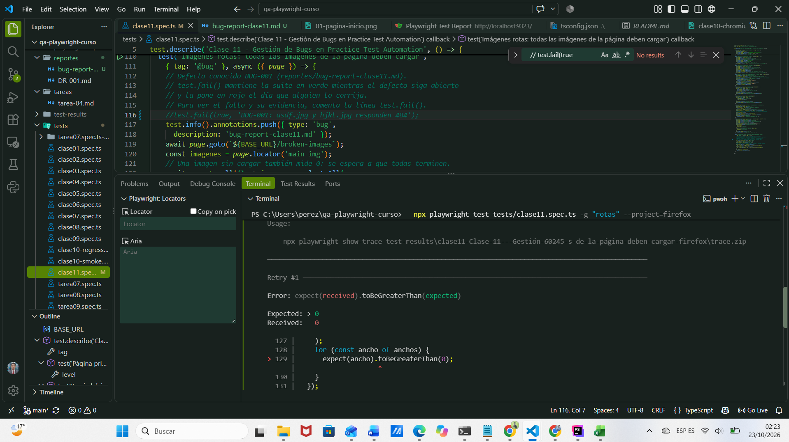
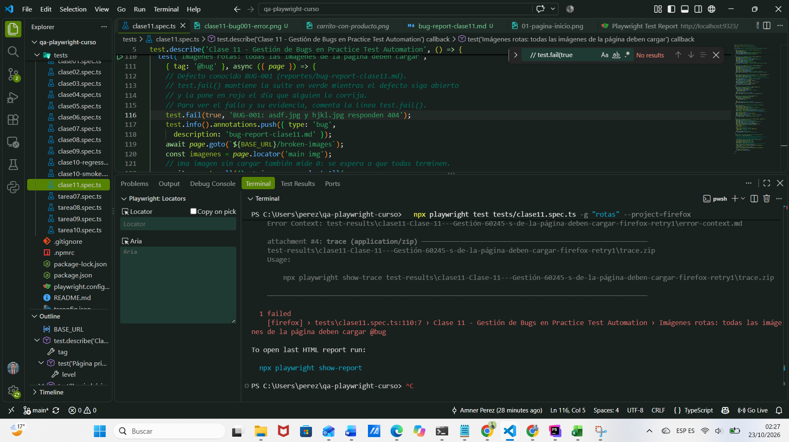

# Bug Report - BR-CLASE11-001

**Título:** Página Broken Images: las imágenes asdf.jpg y hjkl.jpg no cargan (404) en /broken-images
**Fecha:** 23/10/2026
**Reportado por:** Amner Alberto Pérez Marroquín
**Ambiente:** Windows 11, Firefox (Playwright, project `firefox`), https://practice.expandtesting.com/broken-images
**Issue en GitHub:** [#2](https://github.com/PerezAmnerJr/qa-playwright-Curso-perez/issues/2)

## Descripción
En la página Broken Images, dos de las imágenes no se muestran. El navegador recibe un error 404 al solicitarlas, por lo que su ancho real (`naturalWidth`) es 0.

## Severidad: Baja
Es un problema visual: faltan imágenes, pero no se interrumpe ningún flujo ni hay pérdida de datos.

## Prioridad: P3
No bloquea el uso del sitio; puede corregirse en el próximo sprint.

## Frecuencia: Siempre
Falló en 2 de 2 ejecuciones (ejecución original y retry #1) con el mismo resultado.

## Pasos para reproducir
1. Abrir https://practice.expandtesting.com/broken-images
2. Esperar a que la página termine de cargar.
3. Observar las imágenes del contenido principal.

## Resultado esperado
Todas las imágenes de la página cargan y se muestran (ancho real mayor a 0).

## Resultado obtenido
Las imágenes `asdf.jpg` y `hjkl.jpg` responden 404 y no se muestran. El test reporta `Expected: > 0` y `Received: 0`.

## Evidencia
- Test automatizado: `tests/clase11.spec.ts`, test "Imágenes rotas: todas las imágenes de la página deben cargar" (tag `@bug`).
- Error del reporte HTML: 
- Captura de la página: 
- Traza de Playwright: la pestaña Network muestra las respuestas 404.

## Notas adicionales
El test se mantiene con `test.fail()` mientras el defecto siga abierto: la suite queda en verde y se pondrá en rojo el día que el defecto se corrija, como aviso para verificar y cerrar el Issue.